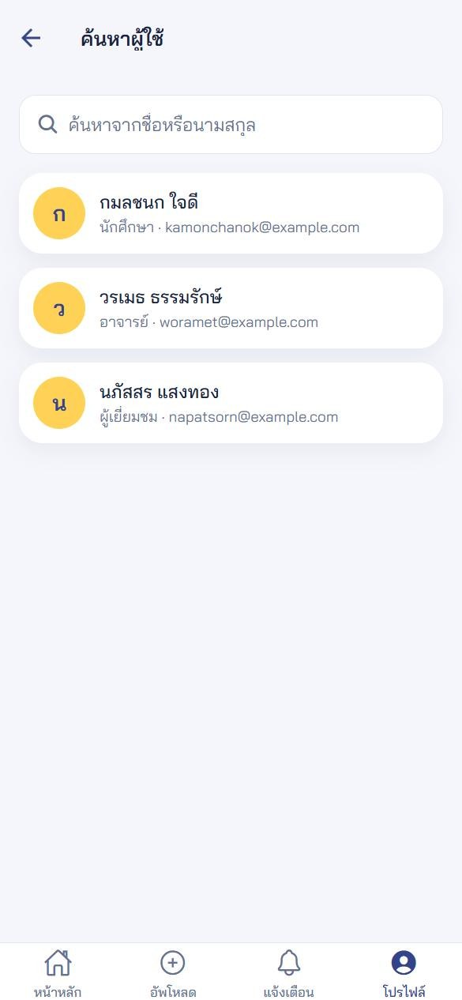
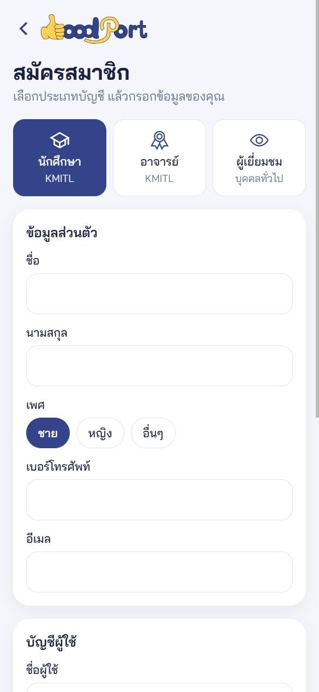
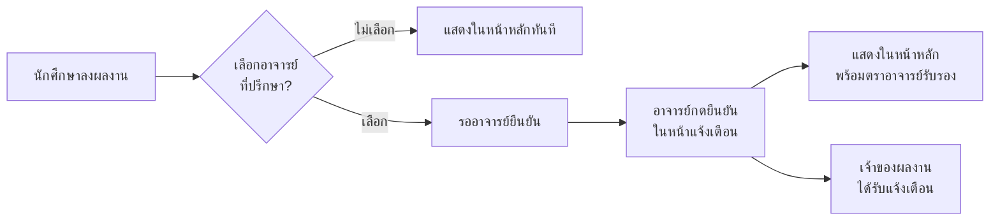

<p align="center">
  
</p>

<p align="center">
  <strong>แอปรวมผลงานของนักศึกษา ที่อาจารย์รับรองได้ และคนที่ตามหาคนเก่ง ๆ ค้นเจอได้</strong>
</p>

<p align="center">
  
  
  
  
  
  
</p>

---

## GoodPort คืออะไร

GoodPort เป็นแอปมือถือสำหรับเก็บผลงานไว้ในที่เดียว นักศึกษาลงโครงงาน กิจกรรม สหกิจ และงานจิตอาสาได้ พร้อมเลือกอาจารย์ที่ปรึกษาให้ช่วยยืนยันว่าเป็นผลงานจริง ส่วนอาจารย์ใช้ประกาศรับสมัครหรือแจ้งข่าว และผู้เยี่ยมชม เช่น ฝ่ายบุคคล เข้ามาค้นหาคนที่มีประสบการณ์ตรงกับที่ต้องการได้

## ภาพตัวอย่าง

> ภาพทั้งหมดแคปจากแอปจริง โดยใช้ข้อมูลสมมติ

<table>
  <tr>
    <td align="center"><br /><b>หน้าหลัก</b><br />ค้นหาและกรองผลงานตามหมวด</td>
    <td align="center"><br /><b>รายละเอียดโปรเจกต์</b><br />แสดงตราอาจารย์รับรอง</td>
    <td align="center"><br /><b>เพิ่มผลงาน</b><br />แนบรูปและ PDF เลือกอาจารย์ได้</td>
  </tr>
  <tr>
    <td align="center"><br /><b>ประกาศอาจารย์</b><br />ข่าวสารและการรับสมัคร</td>
    <td align="center"><br /><b>ความคิดเห็น</b><br />ตอบกลับใต้ประกาศได้เลย</td>
    <td align="center"><br /><b>การแจ้งเตือน</b><br />อาจารย์กดยืนยันผลงานจากที่นี่</td>
  </tr>
  <tr>
    <td align="center"><br /><b>โปรไฟล์</b><br />ผลงานแยกตามหมวด</td>
    <td align="center"><br /><b>ค้นหาผู้ใช้</b><br />ดูพอร์ตของคนอื่นได้</td>
    <td align="center"><br /><b>สมัครสมาชิก</b><br />ฟอร์มเปลี่ยนตามประเภทบัญชี</td>
  </tr>
</table>

## ความสามารถหลัก

| ผู้ใช้ | ทำอะไรได้บ้าง |
| --- | --- |
| **นักศึกษา** | ลงผลงานพร้อมรูปและไฟล์ PDF, เลือกอาจารย์ที่ปรึกษา, ดูพอร์ตแยกตามหมวด, ดูและแสดงความคิดเห็นในประกาศอาจารย์ |
| **อาจารย์** | สร้างและแก้ไขประกาศ, ยืนยันผลงานที่นักศึกษาส่งมา, ดูความคิดเห็นในประกาศ |
| **ผู้เยี่ยมชม** | ดูผลงานล่าสุด, ค้นหาผู้ใช้และเปิดดูโปรไฟล์ ลงผลงานของตัวเองได้ |

### เส้นทางของผลงานหนึ่งชิ้น



## เทคโนโลยีที่ใช้

| ส่วน | เครื่องมือ |
| --- | --- |
| แอป | Expo SDK 49, React Native, TypeScript, React Navigation |
| ฟอร์ม | React Hook Form, Zod |
| Backend | NestJS, Mongoose, JWT, bcrypt, Swagger |
| ฐานข้อมูล | MongoDB |
| เก็บไฟล์ | Firebase Storage |

## เริ่มต้นใช้งาน

สิ่งที่ต้องมี: [Node.js](https://nodejs.org/) 18 ขึ้นไป และ MongoDB (ติดตั้งในเครื่องหรือใช้ [MongoDB Atlas](https://www.mongodb.com/atlas) ก็ได้)

**1. ติดตั้งแพ็กเกจ**

```bash
git clone https://github.com/thampaponn/GoodPort.git
```

```bash
cd GoodPort
```

```bash
npm install
```

```bash
npm --prefix backend install
```

**2. ตั้งค่า backend**

คัดลอก `backend/.env.example` เป็น `backend/.env` แล้วกรอกค่าของตัวเอง

| ตัวแปร | ความหมาย |
| --- | --- |
| `DB_URI` | connection string ของ MongoDB |
| `JWT_SECRET` | ค่าลับสำหรับเซ็น token ควรเป็นข้อความสุ่มยาว ๆ |
| `PORT` | พอร์ตของ API ไม่ใส่ก็ได้ ค่าเริ่มต้นคือ `3000` |

**3. รัน backend**

```bash
npm --prefix backend run start:dev
```

เปิด [http://localhost:3000/api](http://localhost:3000/api) เพื่อดูเอกสาร API (Swagger)

**4. รันแอป** (เปิด terminal ใหม่)

```bash
npm run web
```

วิธีนี้เปิดแอปในเบราว์เซอร์ได้ทันที ถ้าจะรันบน emulator ใช้ `npm run android` หรือ `npm run ios`

แอปหา IP ของเครื่องที่รัน Expo ให้เอง จึงไม่ต้องแก้ IP ในไฟล์อีกแล้ว ถ้า API อยู่ที่อื่น ให้ตั้งตัวแปร `EXPO_PUBLIC_API_URL` ก่อนรัน

> **หมายเหตุเรื่อง Expo Go:** โปรเจกต์นี้ใช้ Expo SDK 49 ซึ่งแอป Expo Go รุ่นล่าสุดเปิดไม่ได้ ถ้าจะทดสอบบนมือถือจริงให้ใช้ Android emulator หรือทำ [development build](https://docs.expo.dev/develop/development-builds/introduction/)

## โครงสร้างโปรเจกต์

```text
GoodPort/
├── App.tsx                จุดเริ่มต้นของแอป
├── src/
│   ├── api/               ฟังก์ชันเรียก backend แยกตามข้อมูล
│   ├── components/        การ์ดผลงาน การ์ดประกาศ และหน้าโปรไฟล์
│   │   └── ui/            ชิ้นส่วน UI กลาง เช่น ปุ่ม ช่องกรอก ชิป
│   ├── config/            ค่า API URL และ Firebase
│   ├── constants/         ชื่อและไอคอนของหมวดหมู่ บทบาท
│   ├── context/           สถานะการเข้าสู่ระบบ
│   ├── hooks/             hook ที่ใช้ซ้ำ
│   ├── navigation/        การนำทางทั้งหมดของแอป
│   ├── schemas/           กติกาตรวจฟอร์มด้วย Zod
│   ├── screens/           หน้าจอแยกตามฟีเจอร์
│   ├── services/          เลือกและอัพโหลดไฟล์
│   ├── types/             type ของข้อมูล
│   ├── utils/             ฟังก์ชันจัดรูปแบบ
│   └── theme.ts           สี ระยะห่าง และฟอนต์
├── backend/src/           NestJS แยกโมดูล auth, user, post,
│                          post-advisor, alert และ comments
├── assets/                โลโก้ ไอคอน และฟอนต์ Bai Jamjuree
├── docs/screenshots/      ภาพใน README
└── patches/               แพตช์ที่ทำให้ Expo 49 รันบน Windows + Node รุ่นใหม่ได้
```

## คำสั่งที่ใช้บ่อย

| คำสั่ง | ใช้ทำอะไร |
| --- | --- |
| `npm run web` | รันแอปบนเบราว์เซอร์ |
| `npm run android` | รันบน Android emulator |
| `npm run ios` | รันบน iOS simulator |
| `npm run typecheck` | ตรวจ TypeScript ของแอป |
| `npm --prefix backend run start:dev` | รัน backend แบบ watch |
| `npm --prefix backend test` | รันเทสต์ของ backend |

## ผู้จัดทำ

| หน้าที่ | สมาชิก | รหัสนักศึกษา |
| --- | --- | --- |
| Frontend, Design | ณุทยา นิติอภัยธรรม | 64070036 |
| Backend, Frontend | ธนาธิป สิงหานนท์ | 64070045 |
| Frontend | ธรรมปพน ประทุม | 64070046 |
